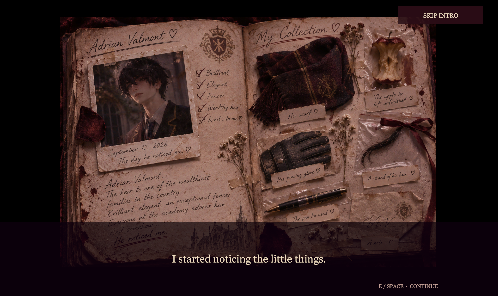
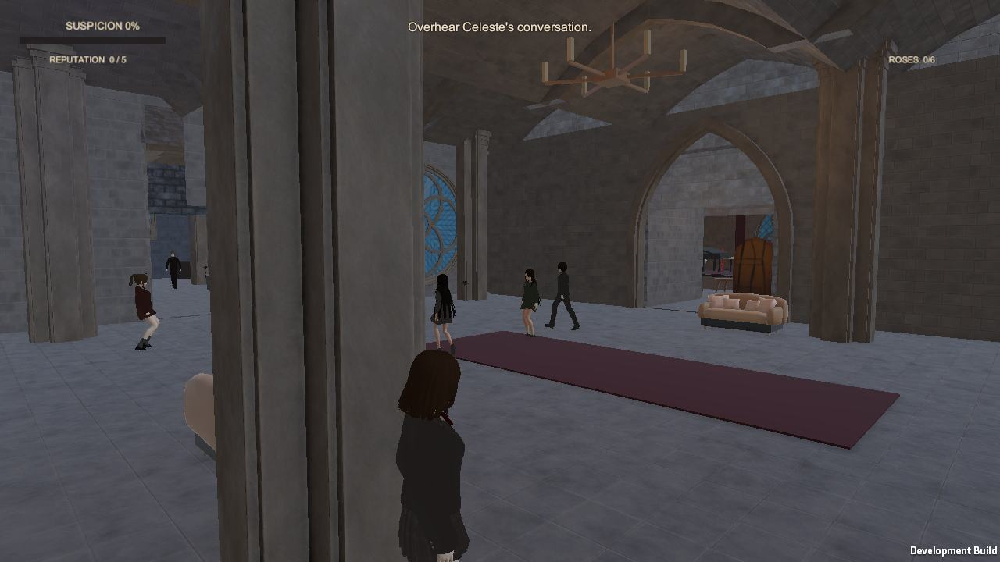
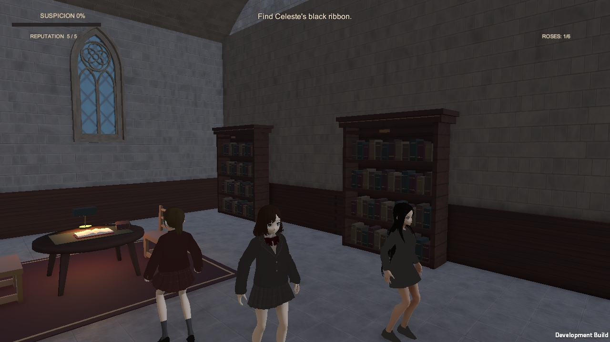
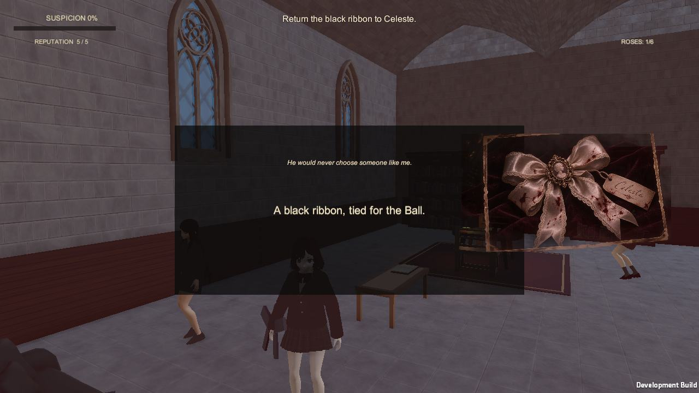
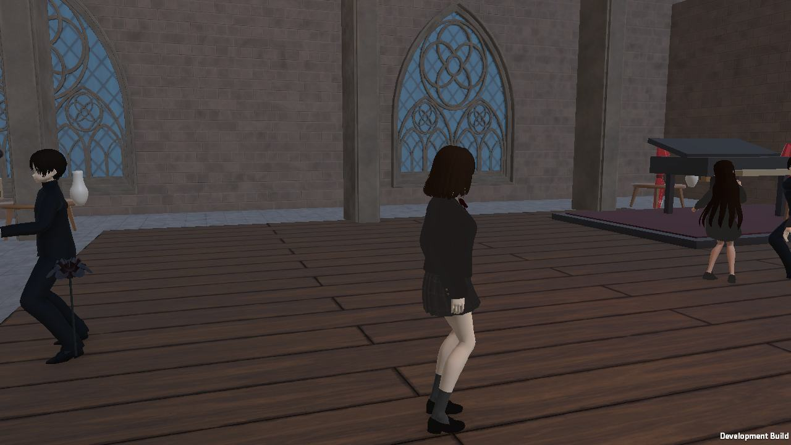
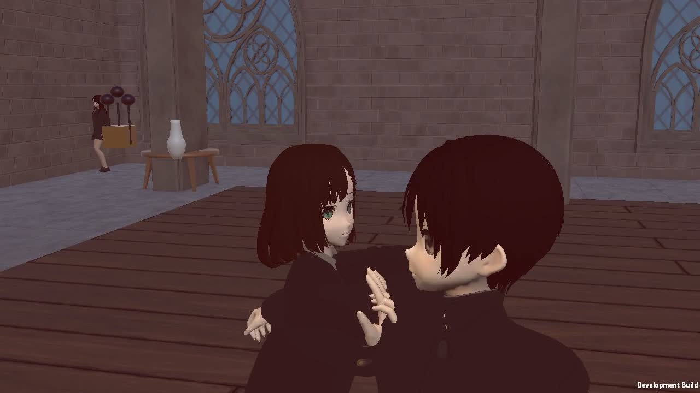

# VELVET VOWS

### A Perfect Duet

**A gothic academy. A private obsession. An evening with consequences.**

Unity 6 · C# · Universal Render Pipeline · Third-person narrative prototype

Velvet Vows is a playable dark romance thriller set inside a gothic academy. Follow Evelyn Moreau through conversations, hidden evidence and a carefully staged evening that moves from the library to the ballroom.

The project combines third-person exploration with a diary-led introduction, character interactions, suspicion and cleanup systems, and a branching finale.

## Inside the academy

| Explore the academy | Follow the story |
| :---: | :---: |
|  |  |
| Stone arches, stained glass and connected interiors | Dialogue, character encounters and narrative objectives |
|  |  |
| Inspectable clues and illustrated story inserts | A staged social scene leading into the finale |

*Actual project captures. The diary image comes from an earlier recorded introduction; the gameplay gallery comes from the Phase 3O recording. [Image sources](docs/portfolio/sources.json).*

## Systems and implementation

- **Narrative flow:** diary introduction, conversations, objectives and BURN / LEAVE ending routes.
- **Third-person interaction:** contextual interaction focus, camera collision handling and recovery, and transitions between exploration and staged sequences.
- **Stealth and consequences:** suspicion, patrol investigation, evidence cleanup and body hiding with route checks and cancellation.
- **Character presentation:** locomotion and action animation, procedural hand placement, expressions, voice playback and a staged ballroom dance.
- **Validation tools:** Unity PlayMode tests, automated standalone routes, screenshot capture and recorded playthroughs.

Project scripts are in [`Assets/VelvetVows/Scripts`](Assets/VelvetVows/Scripts), scene tooling in [`Assets/VelvetVows/Editor`](Assets/VelvetVows/Editor), and tests in [`Assets/VelvetVows/Tests`](Assets/VelvetVows/Tests).

## Open the project

1. Install **Unity 6000.0.84f1** through Unity Hub.
2. Add this repository as a project and allow Unity to import the assets and restore the packages.
3. Open [`Assets/VelvetVows/Scenes/VelvetVows_Main.unity`](Assets/VelvetVows/Scenes/VelvetVows_Main.unity) and enter Play mode.
4. Follow the controls displayed by the game. The interaction key is **E**.

The package manifest includes URP 17.0.4, Cinemachine 3.1.2, Input System 1.20.0 and AI Navigation 2.0.14. Keep Unity `.meta` files alongside their assets when moving or restoring the project.

## Recorded validation

The [Phase 3O report](Phase3O_Captures/Report.md) documents a complete **11:10 BURN playthrough** in a macOS development build, with zero reported Unity errors. It links to the earlier 12/12 regression results and follow-up camera and hand-placement checks. These are existing recorded results, not a new test run performed for this README.

The latest report also describes the prototype's limits: procedural body handling, occasional camera recovery shifts, and a LEAVE route that was last fully recorded in Phase 3M.

## Assets and preservation

This project includes third-party character, environment and animation assets. Their original licenses continue to apply; this repository does not grant permission to redistribute those assets. Keep a full source backup private unless redistribution rights have been checked.

For backup coverage and restoration requirements, see [BACKUP.md](BACKUP.md). A local commit alone is not an off-device backup.
